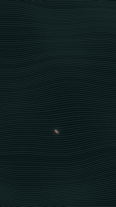
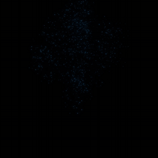
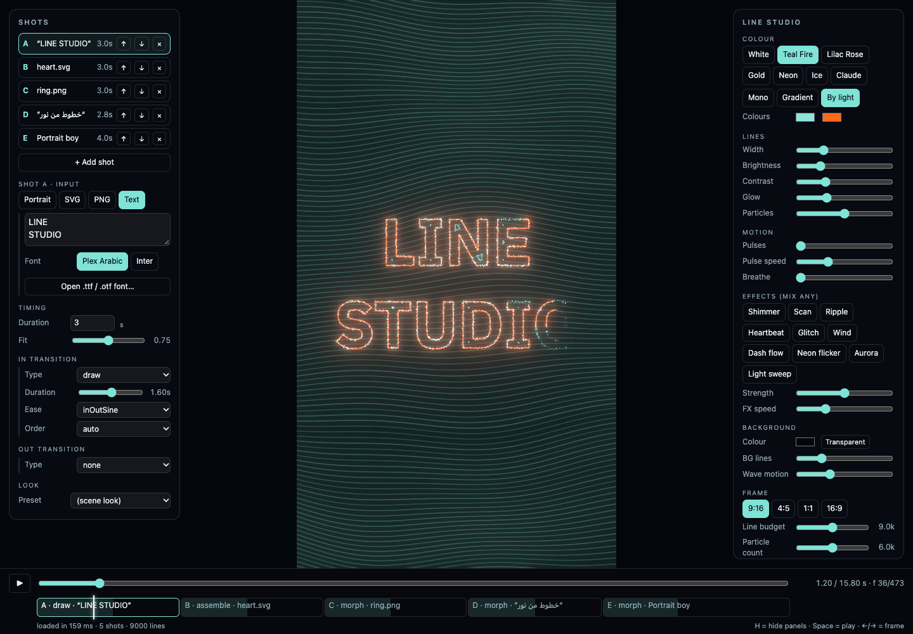
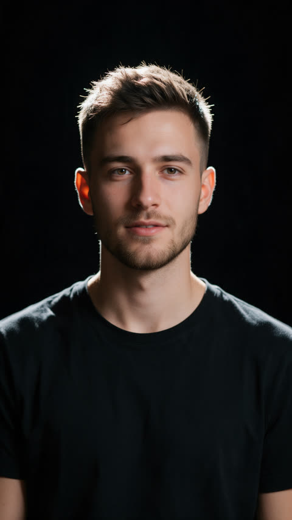
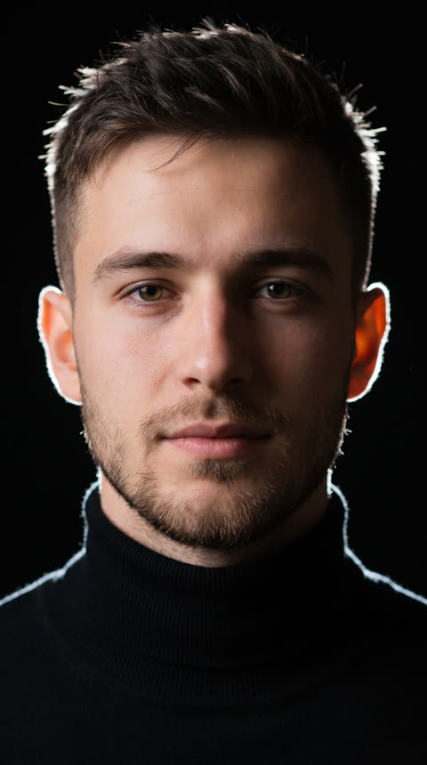
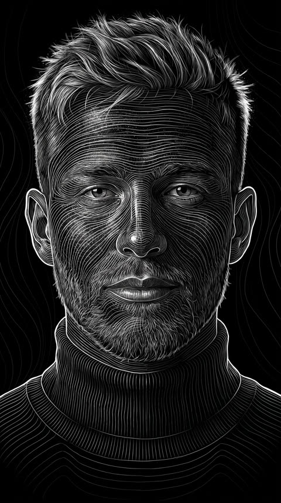
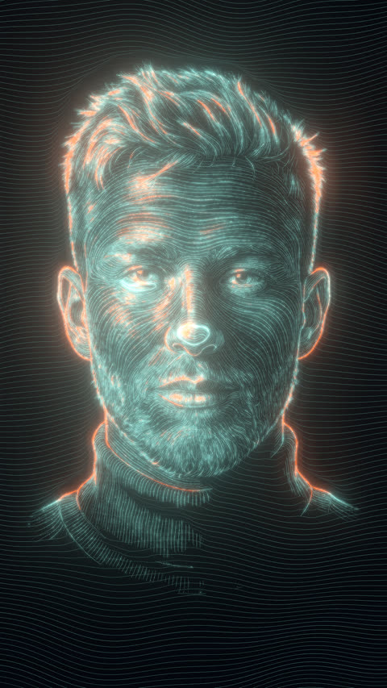

# Claude Line Portrait v2

**A line + particle motion engine.** Give it a face, a product photo, a logo, an icon or any text, Arabic included. You get glowing light lines and particles that draw, assemble, explode, blow away, glitch and morph into each other. Output is a frame-exact MP4, or a **transparent** ProRes 4444 / WebM / PNG sequence that drops onto any After Effects, Premiere, CapCut or Remotion timeline.

<p align="center">
  
  
  
</p>
<p align="center">
  
  
</p>

## What's new in v2
- **Any input.**
  - Portraits use the v1 pipeline.
  - Object and product photos go through `scripts/image2lines.py`, with no image model.
  - SVG icons and logos use exact vector outlines plus inner contour lines.
  - PNG icons are traced.
  - Text in any font is shaped with HarfBuzz, so Arabic joins and runs right to left.
- **Transitions:**
  - draw on / off;
  - assemble / disperse as dust, shards, wind or a vortex;
  - **morph A → B** between any two inputs (icon → text → face);
  - wipe, light sweep, glitch cut, logo sting.
- **Proper eases and staggers.**
- **Editor-ready output.**
  - Transparent ProRes 4444 `.mov`, VP9 alpha `.webm` and PNG sequences, plus MP4 and GIF.
  - Any size and fps: 9:16, 1:1, 4:5, 16:9.
- **Headless.** One JSON scene file goes in, and `node render.mjs scene.json --alpha --out x.mov` renders it. It is frame-exact (`renderFrame(n)`, never a screen recording), and every file is checked by decoding it.
- **Remotion.** `<LineField scene={…} transparent />` is deterministic by `useCurrentFrame()`.
- **After Effects.** `after-effects/import_linefield.jsx` imports the render and places it at the playhead.
- **Studio page.** Build a shot timeline, drop SVGs, PNGs or fonts, type text, scrub, and export MP4, alpha WebM, PNG or scene.json.

<p align="center"></p>

## Quick start
```bash
git clone https://github.com/megomaged/claude-line-portrait && cd claude-line-portrait
npm install                                   # puppeteer-core + harfbuzzjs (needs Google Chrome installed)
node render.mjs examples/icon-sting.json --alpha --out out/logo.mov --out out/logo.webm
node render.mjs examples/morph-icon-text-portrait.json --out out/morph.mp4
cd studio && node serve.mjs 8097              # the studio: http://127.0.0.1:8097/
```
Your own inputs:
```bash
pip install -r scripts/requirements.txt
python3 scripts/image2lines.py product.png studio/data/product          # object / product photo → lines
python3 scripts/flowlines.py my_lineart.png studio/data/me              # portrait (after prompts/01 + 02 in any image model)
```
Then reference them in a scene: `{ "input": { "image": "data/product" } }`, `{ "input": { "svg": "logo.svg" } }`, or `{ "input": { "text": "مرحبا", "font": "fonts/IBMPlexSansArabic-Bold.ttf" } }`.

With Claude Code, drop this folder into your skills and ask, for example:
- *"make a logo sting from logo.svg with a transparent background"*
- *"write «خطوط من نور» in light, right to left"*
- *"morph my logo into my face"*

Claude follows [SKILL.md](SKILL.md): the scene format, every transition and the output rules.

## Portraits (the v1 pipeline, unchanged)
| 1 · Photo | 2 · Cinematic portrait | 3 · Line art | 4 · Drawn by code |
|---|---|---|---|
|  |  |  |  |
| any picture | any image model + [prompt 1](prompts/01_cinematic_portrait.md) | same model + [prompt 2](prompts/02_line_art.md) | `flowlines.py` → scene / studio |

## How it works
- Every input becomes the same thing: polylines with a brightness and width per point, plus particles.
- Each shape is cut into exactly *N* strokes × *M* points, so any two shapes can morph point for point. Strokes are paired along a Hilbert curve, so pieces travel to nearby places.
- three.js draws every segment as an instanced quad with an exact 1-px box filter, so there are no beads at the joints.
- Transitions live in the shader:
  - Draw-on runs along each source line.
  - Collapsing pieces become round particles that carry only their share of light.
  - Wipes and sweeps are per-pixel.
- Bloom is a 5-level blur chain.
- The composite writes either a background or straight alpha (α = the brightest channel), so the glow composites correctly over anything.

## Credits and licence
- MIT, © Maged ElGohary.
- Bundled:
  - three.js (MIT) and harfbuzzjs (MIT; HarfBuzz is "Old MIT").
  - mp4-muxer and webm-muxer (MIT).
  - IBM Plex Sans Arabic and Inter (SIL OFL 1.1).
