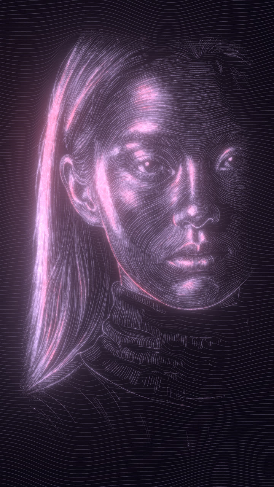
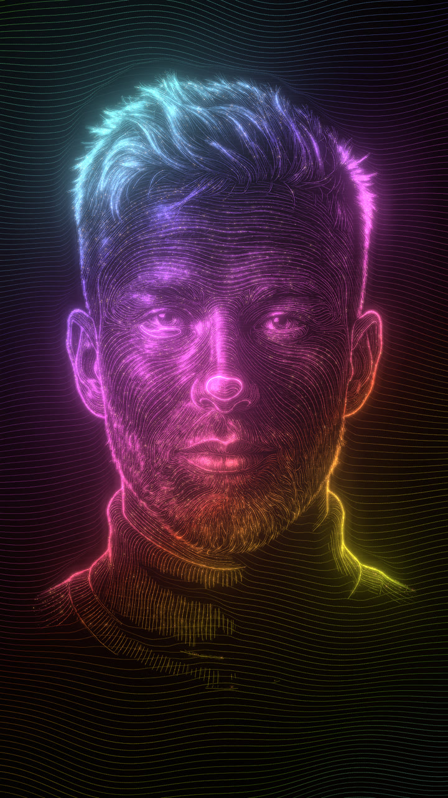
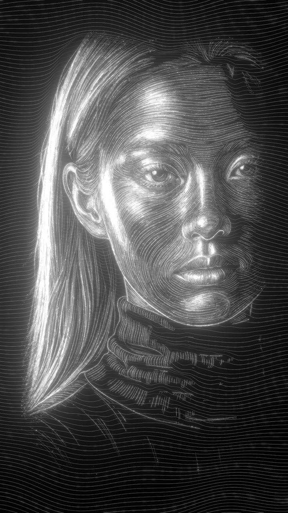
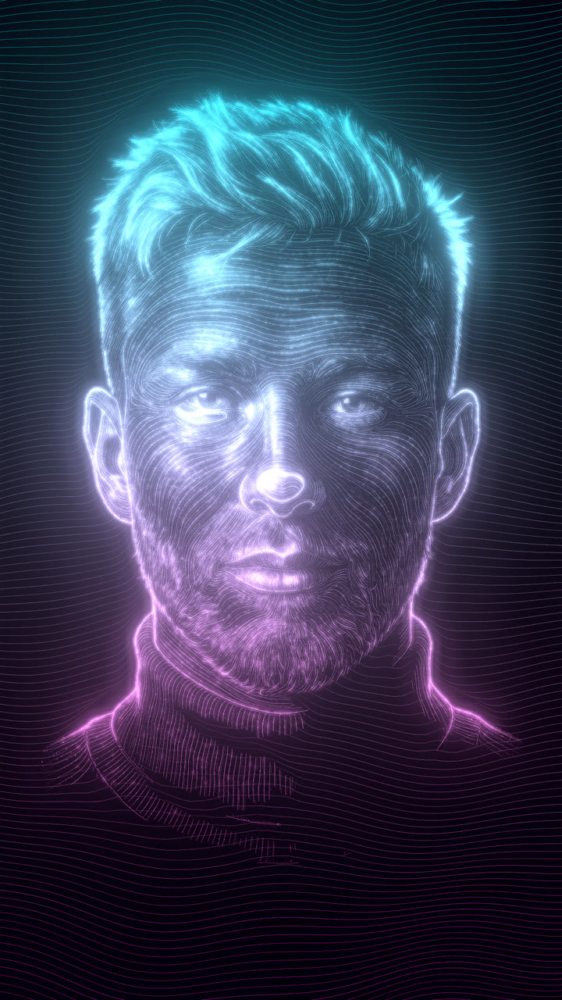
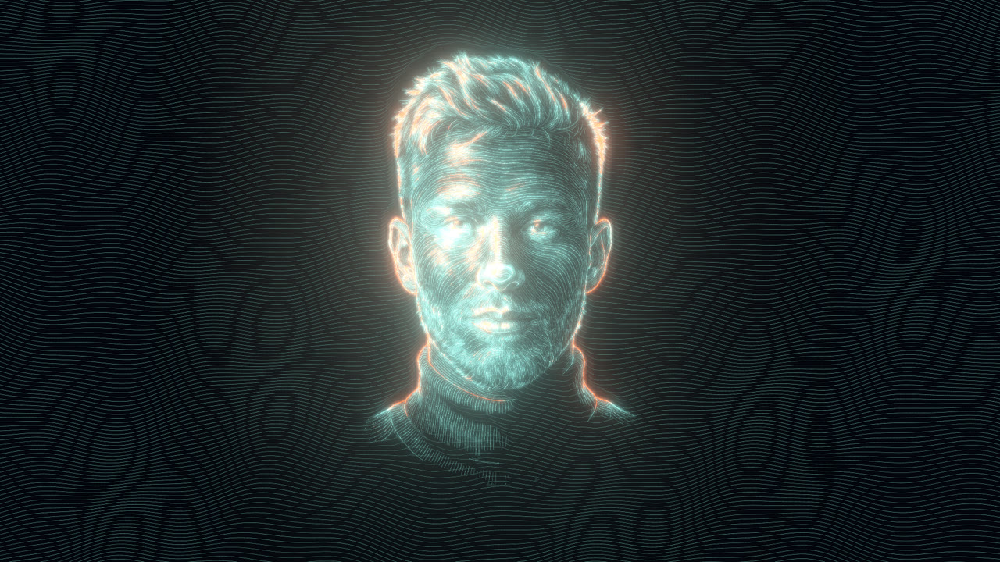

# Claude Line Portrait

**Any photo → a portrait drawn by code with thousands of glowing lines.** It runs as a live web page, with colour presets, glow, 11 motion effects, and a one-click MP4 export at any length.

<p align="center">
  
  
  
</p>

## How it works

| 1 · Photo | 2 · Cinematic portrait | 3 · Line art | 4 · Drawn by code |
|---|---|---|---|
|  |  |  |  |
| any picture | any image model + [prompt 1](prompts/01_cinematic_portrait.md) | same model + [prompt 2](prompts/02_line_art.md) | `flowlines.py` → `studio/` |

1. **Cinematic portrait.** The photo is remade as a studio close-up: black background, a hard side light, and a bright rim. Light is what the lines will draw.
2. **Line art.** The portrait becomes a white-on-black engraving made of flowing lines.
3. **Lines → code.** `scripts/flowlines.py` reads the direction and brightness of the strokes and redraws them as about 7,000 clean vector lines in about 7 seconds.
4. **Studio.** `studio/index.html` draws those lines with three.js shaders. The portrait sits inside a field of moving waves, and you style and export it there.

Steps 1–2 work in any image model that takes a reference image (ChatGPT, Gemini, Midjourney, Magnific, Flux…). Steps 3–4 are local and free.

## Quick start
```bash
git clone https://github.com/megomaged/claude-line-portrait && cd claude-line-portrait
cd studio && node serve.mjs 8097        # open http://127.0.0.1:8097/?d=boy  (or ?d=girl)
```
Your own portrait:
```bash
pip install -r scripts/requirements.txt
python3 scripts/flowlines.py my_lineart.png studio/data/me
# open http://127.0.0.1:8097/?d=me&preset=ember
```
With Claude Code, drop this folder into your skills and ask: *"turn this photo into a line portrait."* Claude follows [SKILL.md](SKILL.md).

## The studio
| | |
|---|---|
| **Looks** | White · Teal Fire · Lilac Rose · Gold · Neon, or your own two colours (mono, vertical gradient, or by light) |
| **Lines** | width · brightness · contrast · glow · particles |
| **Motion** | draw order (top→down, random, centre-out) · draw time · pulses running along the lines · breathe · wave motion |
| **Effects (mix any)** | Shimmer · Scan · Ripple · Heartbeat · Glitch · Wind · Dash flow · Neon flicker · Aurora · Light sweep |
| **Frame** | 9:16 · 4:5 · 1:1 · 16:9 — the waves fill any frame |
| **Export** | Save PNG · **Download video**: choose the seconds and get an MP4 at 1080×1920 / 1080×1350 / 1080×1080 / 1920×1080 |

The video export renders every frame at its exact time and encodes it with WebCodecs, so it never stutters, whatever the machine. Use Chrome or Edge.

<p align="center">
    
</p>
<p align="center"></p>

## Notes
- Use photos of yourself or of people who agreed. Keep the likeness: never "beautify" someone into another person.
- The example faces (`studio/data/boy`, `studio/data/girl`) are AI-generated people, not real persons.

## Credits
[three.js](https://threejs.org) (MIT) · [mp4-muxer](https://github.com/Vanilagy/mp4-muxer) (MIT) · licences in `studio/vendor/`.
Made by [Maged El-Gohary](https://github.com/megomaged) with Claude. MIT licence.
